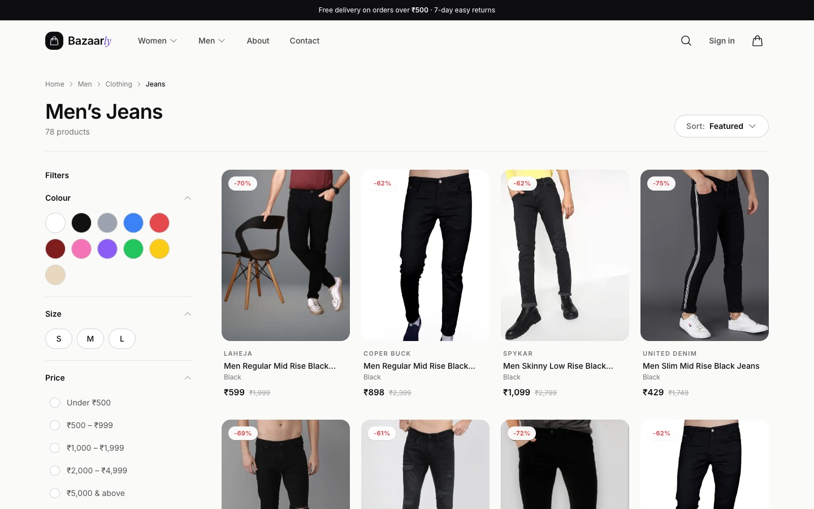
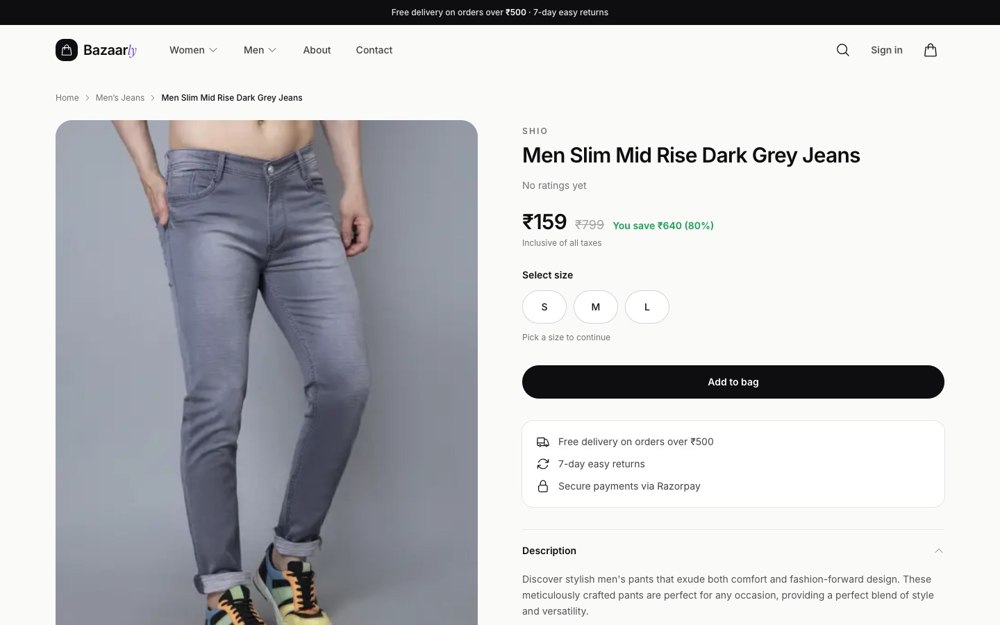
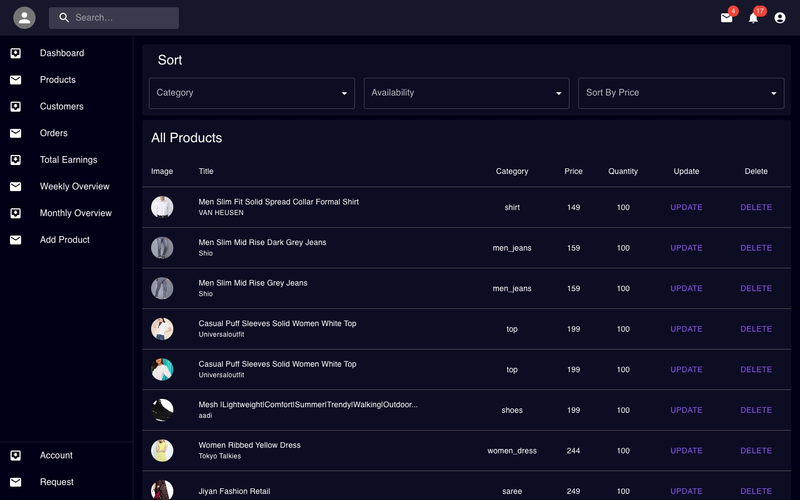

# Bazaarly storefront

[](https://github.com/themukuldharashivkar/ecommerce-frontend/actions/workflows/ci.yml)

The React storefront and admin panel for Bazaarly, a full-stack clothing store. Shoppers browse and filter a 499-product catalog, search, keep a cart and pay through Razorpay (test mode). Admins manage products, stock and orders.

**The architecture, engineering decisions, performance numbers, tests and live demo are in the API's README: [ecommerce-server](https://github.com/themukuldharashivkar/ecommerce-server#readme).**

| Catalog with filters | Product page | Admin panel |
|---|---|---|
|  |  |  |

## Tech stack

React 18 (Create React App), Redux with redux-thunk, React Router 6, MUI and Tailwind CSS, axios. In production it is a static build served by Vercel; the Docker image serves it with nginx.

## Run locally

Needs Node 18+ and the API running at `http://localhost:5454` (see [ecommerce-server: run locally](https://github.com/themukuldharashivkar/ecommerce-server#run-locally)).

```bash
npm ci
npm start          # http://localhost:3000, talks to http://localhost:5454
```

To use a different API, set `REACT_APP_API_URL` (see `.env.example`). Create React App reads it at **build time**, so a change needs a restart or a rebuild.

With Docker, the API repository's Compose file can start the storefront together with the API, database and Redis: `docker compose --profile storefront up --build` (this repository must be cloned next to `ecommerce-server`).

## Scripts

| Command | What |
|---|---|
| `npm start` | development server with hot reload |
| `npm run build` | production build in `build/` |
| `npm run lint` | ESLint over `src/` |

CI (GitHub Actions) runs on every push and pull request. It scans the whole git history for secrets (gitleaks), runs `npm ci`, `npm run lint` and `npm run build`, and builds the Docker image.

## Project layout

| Folder | What |
|---|---|
| `src/customer` | storefront pages and components: home, catalog, product, cart, checkout, orders |
| `src/Admin` | admin panel: products, orders, dashboard |
| `src/Redux` | actions and reducers per feature (auth, products, cart, orders, payment, reviews) |
| `src/config/api.js` | the axios client: API base URL and the JWT header |

## Known limitations

- **No automated frontend tests yet.** CI only lints and builds the app.
- **Admin dashboard and customers page** show static sample data from the original UI template. Only the products and orders pages use the API.
